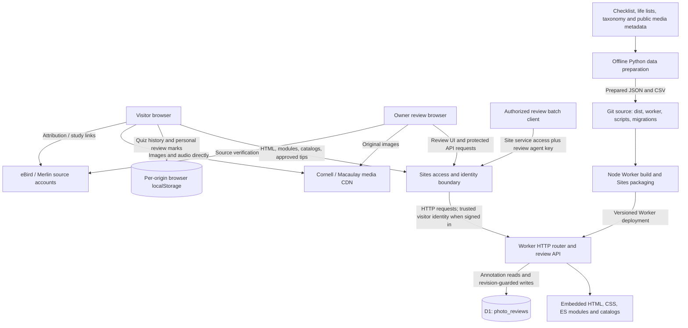

# Aviquiz architecture

Status: current implementation, documented November 1, 2026. Proposed capabilities are identified separately below. This file retains the filename requested for the architecture document.

## System context

Aviquiz provides photo and vocalization identification quizzes from a prepared Colombia trip checklist. Visitors select sites, families, lifer filters, question counts, and regular or mistake-review practice. Experimental photo guidance combines paraphrased eBird/Merlin descriptions with manually checked arrows on specific Macaulay Library photographs.

The deployed application is a browser application plus a small HTTP Worker and a shared database. Quiz selection, answer matching, statistics, and personal annotation-review marks run in the browser. The backend serves application assets and manages shared annotation drafts and published snapshots. Media streams directly from Cornell; the backend does not proxy or store it.

Current hosted site: <https://sandy-colombia-bird-quiz.lovelyquail12.chatgpt.site>

Source repository: <https://github.com/ScarletTanager/aviquiz>

The current Sites audience controls entry to the hosted site. Application-level guest use means no separate Aviquiz account; it does not bypass that staging/hosting access policy. Permanent anonymous access to ordinary quizzes is a product requirement for future public production hosting.

## Component interaction diagram

Solid connections represent runtime or build dependencies. The data preparation path is offline; it is not run by a visitor request.

## Component inventory and technology choices

| Component | Source / technology | Responsibility and reason |
| --- | --- | --- |
| Quiz shell and presentation | `dist/index.html`, `dist/style.css`; HTML/CSS | Responsive setup, quiz, statistics, results, and annotation views without a framework or application dependency installation. |
| Browser orchestration | `dist/app.mjs`; JavaScript ES modules | Loads catalogs and shared tips; coordinates filters, media events, sessions, and views. |
| Selection and grading | `dist/quiz.mjs` | Pure selection and common/scientific-name matching, including punctuation normalization and limited, unambiguous typo tolerance. |
| Progress and statistics | `dist/progress.mjs`, `dist/statistics.mjs`; localStorage | Separate photo/audio rolling histories and weighted summaries without requiring an Aviquiz account or backend personal-data storage. |
| Personal annotation review | `dist/annotation-review.mjs` | Tracks explicitly reviewed photo IDs separately from shared publication and quiz accuracy. |
| Audio selection | `dist/audio.mjs`, `dist/audio.json` | Ranks saved Macaulay records by geographic preference. A local catalog makes behavior repeatable and avoids an archive search on every quiz. |
| Photo guidance | `dist/id-tips.mjs`; generated SVG | Combines shared annotations with species text and built-in fallback guidance. Normalized coordinates and uncropped images retain landmark placement across display sizes; labels sit outside the image. |
| Shared review UI | `dist/review.html`, `dist/review-app.mjs`, `dist/review.css` | Owner editing, preview, approval, withdrawal, export, and breadth-first queue. |
| Review validation | `dist/review-core.mjs` | Shared browser/server validation and coverage rules reduce inconsistent approval behavior. |
| HTTP backend | `worker/index.mjs`; Worker ESM, Web Request/Response APIs | Serves embedded assets and a small JSON API without a long-running application server. |
| Shared persistence | D1 binding `DB`; SQLite-compatible SQL | Stores annotation documents, published snapshots, and revision numbers. Transactional statement guards prevent stale edits and competing approvals from violating review rounds. |
| Build | `scripts/build-worker.mjs`; Node.js | Embeds authored assets and shared validation into generated `dist/server/index.js`. The generated bundle is ignored by Git. |
| Deployment | Sites tools/helper and `.openai/hosting.json` | Packages a pushed source revision, deploys a saved version, provisions the declared database migration, and preserves the site's access policy. |
| Offline preparation | `prepare_data.py`, `finalize_photos.py`, `scripts/prepare-audio-catalog.py`; Python, `openpyxl` for workbook parsing | Converts source documents and public metadata into runtime catalogs. These tools are not required for an ordinary code deployment. |
| Batch annotation maintenance | `scripts/review-agent.mjs`; Node.js | Sequential, revision-aware shared-data updates without a code deployment. It does not itself inspect or approve the accuracy of images. |

`dist/` is primarily authored source despite its name. Only its generated `server/` and `.openai/` subdirectories are ignored build output. There is currently no package-manager build/install step. Node 24+ is used for tooling/tests, including `node:sqlite` in backend tests; it is not the browser or deployed Worker runtime.

## Data inventory and ownership

| Data | Location | Durability / scope |
| --- | --- | --- |
| Prepared species, taxonomy, site X flags, photos, and lifer booleans | Versioned `dist/data.json` | Shared, deployed with source. Lifer flags currently reflect the original user's export, not a visitor's own life list. |
| Audio IDs, credits, localities, and provenance | Versioned `dist/audio.json` | Shared, deployed with source; incomplete catalog. |
| Trip lifer comparison | Versioned `dist/trip_lifer_comparison.csv` | Downloadable prepared output. |
| Original workbook and personal observation inputs | Parent workspace, outside the app's runtime assets | Not sent to visitors or bundled into the Worker. Preparation currently depends on local files, including temporary taxonomy input. |
| Photo/audio binaries | Cornell infrastructure | External availability; no bundled or backend-hosted media copies. |
| Shared annotation drafts and approved snapshots | D1 `photo_reviews` | Cross-device shared content, independent of Git and application deployments. |
| Visual attempts | localStorage `colombia-field-quiz:progress:v1` | This browser profile and origin only. |
| Audio attempts | localStorage `colombia-field-quiz:audio-progress:v1` | Independent from visual attempts. |
| Personal annotation-review marks | localStorage `colombia-field-quiz:annotation-review:v1` | Photo IDs marked by the visitor; no cross-device sync and no revision-based reset. |

The original catalog has 849 species and 13 named sites, with four photo records per species. Audio initially covers 188 species with 674 recordings. The last verified annotation batch on October 31, 2026 brought published coverage to 126 photos across 123 species. These are dated baselines, not constants; query the live API for current review coverage.

Browser storage is not identity or an authorization boundary. Clearing site data, changing browser profiles, or moving the site to another origin does not transfer these histories. A separate memory fallback allows practice when browser storage fails, but it does not provide durable recovery.

## Important runtime flows

### Quiz and statistics

The browser fetches checklist/audio catalogs, selects eligible media, and streams the chosen asset directly from Cornell. Audio requires playback before an answer can be scored. It prefers named site-area records, then department, Colombia, neighboring countries, and broader fallbacks within the saved catalog. Site subspecies and recording elevation matches are not verified.

Each medium retains the last 20 scored attempts per species. Mistake review includes species with a strictly greater than 25% miss rate. Statistics divide retained correct attempts by retained scored attempts, rather than averaging species percentages. A site's X-marked species can contribute answers made in other quiz scopes. Reveals are misses; unavailable/unclear media skips do not count.

The optional Site-only quizzes view uses separately recorded per-site/per-species windows within each medium's existing progress object (`siteSpecies`). Only quizzes scoped to that exact site with All families selected qualify, including site-scoped mistake reviews. Both views are tracked independent of the display switch; family summaries and mistake-review eligibility remain general. Old records lack scope and cannot be attributed retrospectively. `dist/site-clue.mjs` supplies an independent optional checklist-site clue for family/all-sites questions: the browser chooses one valid site per question, retains it through toggles/media retries, and keeps the off-by-default visibility preference for the page visit. This does not assert media locality or change selection/scoring.

All sessions with experimental ID tips enabled bypass progress writes, including correct answers and species without tips. Personal annotation review likewise never affects learning statistics. Earlier saved attempts cannot be retrospectively separated into experimental and normal sessions.

### Annotation publication and personal review

At startup and before a new photo quiz, the browser requests approved snapshots from `/api/annotations`. Normal experimental quizzes show guidance after a wrong/revealed answer. Exact approved photographs get arrows; other photographs of covered species get general text with visibility caveats. The dedicated personal-review mode shows the species and annotations directly and filters out explicitly marked photo IDs.

An owner or authorized batch client saves a draft or approves a document. Draft edits preserve the last published snapshot. Approval replaces it; `unpublish` removes it. Each successful save increments a revision. Stale requests return 409. New-photo approvals obey a global breadth-first round; revising an already approved photo remains possible.

`photo_reviews` stores `photo_id`, `species_id`, `status`, `revision`, `document_json`, `approved_json`, and `updated_at`. This is current state plus one published snapshot, not a full audit/version history. Published API responses exclude private notes and source/photo-check flags.

### HTTP surface

| Route | Current purpose / access |
| --- | --- |
| `/`, static asset paths | Quiz and authored assets, subject to hosting access policy. |
| `/review` | Review application shell; the shell itself does not grant API permissions. |
| `GET /api/annotations` | Published annotation snapshots and coverage, subject to hosting policy. |
| `GET /api/reviews` | Drafts, published state, revisions, and coverage; owner or review agent only. |
| `POST /api/reviews/save` | `draft`, `approve`, `skip`, or `unpublish`; owner or review agent only. |
| `POST /api/reviews/seed` | Idempotent original six-photo import; maintenance only. |

## Security boundaries

Sites supplies the current hosting access boundary and trusted visitor identity headers. The Worker allows review editing for the configured owner identity/email or the review agent key. These headers are trusted only behind the hosting boundary; running this Worker on a new provider requires replacing or reproducing that trust boundary before exposing protected APIs.

The owner's current ID is in `worker/index.mjs`; `REVIEW_OWNER_EMAIL` handles the platform's site-scoped identity case. `REVIEW_AGENT_KEY` is a runtime secret. Its ignored local counterpart `.review-agent.json` is used by the batch client. Unattended hosted requests also use the platform service credential. Platform access does not itself give a caller a visitor identity or application editing privileges.

Server checks include JSON payload validation, same-origin checks when an Origin header is supplied, revision checks, and approval guards. This is a narrow owner/agent model, not the proposed general AAA system. There is no Aviquiz password store, customer signup, per-user feature authorization, general admin console, comprehensive audit trail, or Turnstile integration today. Experimental UI options are not currently restricted by per-user grants.

## Availability and operational limits

The application depends on Sites dispatch, the deployed Worker, D1 for shared tips/reviews, and Cornell for playable media. A database/API failure can leave ordinary quiz functionality available using already loaded or built-in photo guidance. An audio-catalog load failure disables audio while retaining photo practice. Unavailable external media has retry/skip paths.

There is no application health endpoint, background job, scheduler, queue, full local Worker/D1 development launcher, implemented maintenance switch, or application-managed shutdown endpoint. The Worker is request-driven. Provider monitoring, database recovery, and access controls must be operated through supported provider facilities; the repository does not configure alerting or automated backups.

See [RUNBOOK.md](RUNBOOK.md) for deployment, verification, backups, and incident diagnosis. Existing feature details remain in [README.md](README.md), [AUDIO.md](AUDIO.md), and [REVIEW.md](REVIEW.md).

## Dormant account foundation

Server-only `worker/identity.mjs`, `worker/permissions.mjs`, and `worker/accounts.mjs` now provide identity mapping, global and per-route authorization, private route shells/sharing, and transactional audit records. `schema/identity-routes.sql` is staged outside active migrations; `test-accounts.mjs` validates it in isolated SQLite. These modules are not imported by the deployed Worker and do not alter the runtime diagram, owner/agent authorization, or guest quizzes. They are a foundation, not activated AAA or route features. See [AAA.md](AAA.md) for boundaries, permissions, implemented methods, and activation requirements.

## Planned evolution, not activated

- Permanent guest quizzes, with independent managed Aviquiz authentication for account-backed capabilities. Provider selection and hosting compatibility remain undecided; production may use Azure or another host.
- Immutable internal user IDs linked to verified provider identities; no application password storage. Global grants for administration, experimentation, and annotation editing/publication.
- Server-owned routes: ordered sites and optional dates, private/public visibility, owner-only deletion except explicit administrator intervention, invited viewers, contributors, and optional editors. Per-route permissions must be checked server-side.
- Account-backed history and personal review marks with explicit, deduplicated import of local history. Staging and production identity/data must be isolated.
- Versioned eBird bulk-data ingestion and derived seasonal/geographic species lists. This requires an ingestion/storage design and confirmation of permitted use, including commercial-guide use, attribution, redistribution, and sensitive-species handling.
- Audit events, stronger privileged-user authentication, and optional later Turnstile integration.

The current SQL binding and Sites identity integration are provider-specific. A hosting migration is more than moving static files: port the Worker/API, storage access and migrations, secrets, identity verification, data, and operating procedures; verify public guest access separately.
